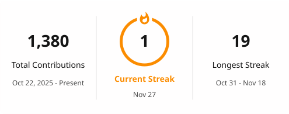

<h1 align="center">Hi, I'm Arjay Japitana</h1>

  Information Systems student • aspiring Systems &amp; Web Developer

  
  
  

---

## About Me

I'm an Information Systems student who enjoys turning ideas into working software. Most of what you'll find here are hands-on builds where I'm practicing the full loop — designing the UI, wiring up state, connecting a backend, and shipping something that runs in a browser.

Right now I'm most comfortable on the web side (React + Vite + Tailwind), and I'm slowly stretching into fuller stack territory with PHP and MySQL through a real project (`nurse1`). On the automation side, I build **Telegram bots in Python** and wire up workflows with **n8n**, **Make**, and **GoHighLevel**.

---

## Tech Stack

**Languages**

**Frontend**

**Backend &amp; Data**

**Automation**

**Tooling**

---

## Projects &amp; Builds

### [Portfolio](https://github.com/arjayjapitana74-droid/Portfolio)
My developer portfolio site — a multi-page showcase of my skills, projects, and experience. It includes dedicated reference pages for each of the languages I've studied (C, HTML, CSS, JavaScript, Java, Python, Visual Basic), with animated navigation and interactive UI touches.

Built with **HTML**, **CSS**, and **JavaScript**, styled with **Bootstrap** and **Font Awesome**, and animated with **GSAP**.

`HTML` `CSS` `JavaScript` `Bootstrap` `GSAP`

> More projects are in development in private repositories and will be released here as they mature.

---

## Currently Learning

- Deeper **React + TypeScript** patterns (hooks, forms with `react-hook-form` + `zod`, state with `@tanstack/react-query`)
- Building **full-stack apps** end-to-end with PHP and MySQL
- Component-driven UI with **shadcn/ui** and accessible **Radix** primitives
- Motion &amp; interaction design with **GSAP** and **Framer Motion**
- Deployment workflows on **Vercel**

---

## Goals

- Finish my Information Systems degree with a strong portfolio of shipped projects
- Grow into a well-rounded **Systems / Web Developer** who can own a feature from database to UI
- Contribute to real-world projects and collaborate with other developers
- Keep the habit of building in public — one small, finished thing at a time

---

## GitHub Activity

  <picture>
    <source media="(prefers-color-scheme: dark)" srcset="profile/streak-dark.svg" />
    <source media="(prefers-color-scheme: light)" srcset="profile/streak.svg" />
    
  </picture>

  <picture>
    <source media="(prefers-color-scheme: dark)" srcset="profile/contribution-graph-dark.svg" />
    <source media="(prefers-color-scheme: light)" srcset="profile/contribution-graph.svg" />
    
  </picture>

  <b><!-- CONTRIBUTIONS:START -->1,289<!-- CONTRIBUTIONS:END --> contributions in the last year</b>

Stats and graph are regenerated daily by GitHub Actions.

---

## Contact

- GitHub: [@arjayjapitana74-droid](https://github.com/arjayjapitana74-droid)
- Open an [issue on any of my repos](https://github.com/arjayjapitana74-droid?tab=repositories) if you'd like to reach out about a project

Thanks for stopping by — feedback and collaboration are always welcome.
